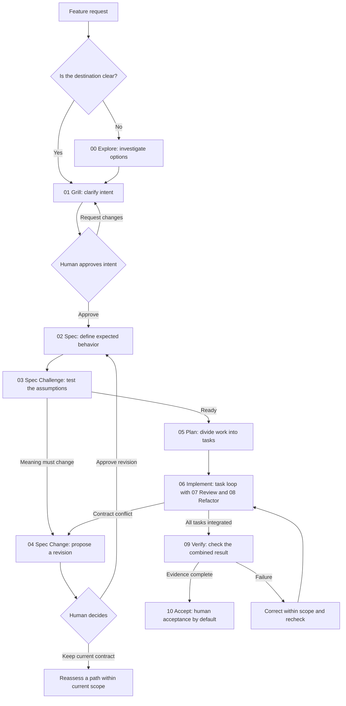
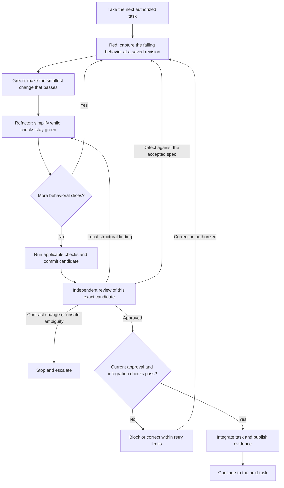
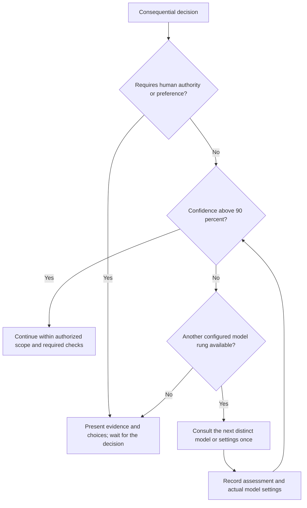

<p align="center">
  
</p>

# KARBAND Agent Starter Kit

KARBAND helps you delegate software work to AI agents while keeping control of what gets built and when it is accepted. It adds a shared workflow to your repository: clarify the request, agree on expected behavior, implement small tasks, review the changes, and collect evidence that they work.

You own the product decisions. Agents handle engineering work within the scope you approve. Decisions, specifications, and results live in versioned files so another session can pick up where the previous one stopped.

The kit consists of instructions, policies, templates, and command-line tools that fit into an ordinary Git repository. Cursor is the first-class runtime binding; [Codex stage skills](_ask/docs/codex-integration.md) are also available. The installer and existing commands use the names **AskIt**, `askit`, and `./ask`.

[Get started](#install-askit) · [Stages](#how-work-moves-through-the-stages) · [Implementation loop](#inside-the-implementation-loop) · [Escalation](#when-an-agent-continues-consults-or-stops) · [Documentation](#documentation-index)

## How this helps build more reliable software

An agent can write working code for the wrong requirement. It can also miss a defect in its own work, lose an earlier decision between sessions, or quietly change a requirement to make a test pass. KARBAND puts a check at each of those points.

| What can go wrong | How the kit addresses it |
| --- | --- |
| A vague request becomes the wrong feature. | Grill makes the goal and assumptions explicit; you approve the complete intent before feature implementation. |
| The specification overlooks an important case. | An independent Spec Challenge looks for contradictions, counterexamples, and gaps in acceptance criteria. |
| A change passes review, then changes again. | Task reviews are tied to an exact candidate commit. Editing that candidate requires fresh checks and review. |
| An agent says the work passes without useful evidence. | Verification executes the configured checks and records the commit they apply to. An empty mandatory check plan fails. |
| A fix grows into an unapproved redesign. | Scope changes go through Spec Change; broader cleanup is parked for later. |
| A new session loses the reason behind a decision. | Workstream files, task evidence, and Git milestones retain the decisions and progress. |

For example, “let customers cancel orders” leaves important questions open. Can they cancel after dispatch? What happens if cancellation and dispatch happen together? Grill and Spec make those decisions explicit. Challenge tests the interpretation. Implementation and verification then check the accepted behavior. If a different cancellation rule becomes necessary, that returns to you as a proposed change.

These controls help expose mistakes and make changes easier to review and recover. Their value still depends on the quality of the requirements, checks, and human decisions; passing the workflow does not guarantee defect-free software.

## How work moves through the stages

The agent first identifies the kind of request. A **feature** adds or changes expected behavior. A **bug fix** repairs a violation of an existing expectation and starts by reproducing the reported fault. A request containing both is split into separate workstreams with explicit dependencies.

A *workstream* is one bounded piece of work with its own branch, specification links, and files under `work/<work-id>/`.

The diagram shows the feature path with an active task graph. A task graph records the implementation tasks, their dependencies, allowed paths, and completion evidence.



| Stage | What it answers | What it leaves behind |
| --- | --- | --- |
| **00 Explore** | What direction is worth pursuing? | An exploration map and a handoff to Intent. Skip this stage when the destination is already clear. |
| **01 Grill** | What do you want, why, and under which assumptions? | The complete intent for your approval, plus the workstream's model plan. |
| **02 Spec** | Exactly what should the software do? | A specification with behavior, constraints, and acceptance criteria. |
| **03 Spec Challenge** | Does that specification actually express the intended problem? | Independent findings, including counterexamples and unresolved decisions. |
| **04 Spec Change** | Does new evidence require a different contract? | A proposed change, its impact, and a human decision. This is an interrupt when needed. |
| **05 Plan** | What tasks deliver the specification, and how will each be checked? | A plan with dependencies, ownership, and required evidence. |
| **06 Implement** | Can the agent build the agreed behavior within its assigned scope? | Code, tests, commits, and task results. |
| **07 Review** | Does the current candidate meet the specification and project policy? | Independent findings tied to that candidate. |
| **08 Refactor** | How should valid findings be corrected? | Corrections with fresh checks, or an explicit escalation. |
| **09 Verify** | What evidence supports the combined result? | Executed checks and the exact commit they verified. |
| **10 Accept** | Is the work eligible to close under the project's policy? | An acceptance decision with its evidence. |

With an active task graph, Review and Refactor happen **inside each implementation task**. They are not repeated as unconditional outer passes after every task has integrated. Aggregate Verify and Accept still follow. The [stage contracts](.agents/ask/stages/) define each role.

On the default feature path, you approve the complete intent and later accept the finished work. Agents prepare the intervening artifacts and continue within that authorization. Changed scope, high-risk actions, and unresolved decisions can require additional human input. An explicit instruction to stop at an earlier stage remains binding.

A reproduced bug follows a shorter path: record the expected and observed behavior, reproduce the fault, add a focused regression, make the smallest fix, review it, and verify it. It reuses the existing contract. If the bug cannot be reproduced, the agent records what it tried and gathers more evidence. See the [workflow policy](_ask/policies/workflow.md).

## Inside the implementation loop

Each task is small enough to review as a unit. The task graph controls its order and dependencies, and the coordinator admits one committing writer at a time.



**Red → Green → Refactor** means first showing the expected behavior fail, then implementing it, then improving the code without changing the behavior. For a reported bug, reproduction comes before its regression test. Purely structural cleanup keeps existing checks green; it does not need an invented failing behavior test.

Review findings determine the next action. A local defect returns to the loop. A valid local cleanup is completed and reviewed again. A broader refactor is recorded for later coordinator handling. A required behavior or contract change stops the task and enters Spec Change.

Every changed candidate loses its previous approval. The coordinator integrates only the current approved candidate with passing checks; a worker's claim that tests passed is insufficient. Failed checks, unresolved findings, or exhausted retries block or escalate the task. See the [canonical task loop](.agents/ask/task-loop.md) and [evidence format](_ask/docs/inner-loop-evidence.md).

## When an agent continues, consults, or stops

Two considerations guide escalation: **authority** and **uncertainty**. Some decisions belong to the human regardless of how confident an agent feels. Other decisions are already authorized but need another technical assessment.



For consequential uncertainty, the kit uses the active runtime's configured model ladder. At **90% confidence or below**, the agent consults the next distinct model or settings before escalating unresolved technical uncertainty to you. It checks availability, records the assessment, and does not repeat a rung for the same decision and evidence. If the ladder is exhausted or unavailable and material uncertainty remains, it asks you.

That confidence is a subjective judgment, not a measured probability of correctness. Consultation cannot grant permission, change acceptance criteria, replace the assigned independent reviewer, or waive verification.

The default risk policy determines how much authority the agent has:

| Risk | Default handling |
| --- | --- |
| Low | Continue autonomously with normal checks. |
| Medium | Continue autonomously with stronger verification. |
| High | Prepare a proposal and obtain human approval. |
| Critical or irreversible | Human authority is mandatory. |

Risk depends on reversibility, blast radius, external impact, data loss, security, and business consequences. Projects should adapt these defaults to their domain. A short database command can carry more risk than a large documentation change.

Scope changes, destructive data operations, production-impacting actions, contradictory evidence, and repeated fixes that do not converge are escalation triggers. See [delegation](_ask/policies/delegation.md), [risk](_ask/policies/risk.md), and [model-confidence escalation](_ask/policies/workflow.md#model-confidence-escalation) for the full rules.

## Install AskIt

Copy and paste this into a terminal:

```bash
(
  sha=b66d707d53f0b2807fba6b7f355312503be366c6
  installer="$(mktemp)" || exit
  trap 'rm -f "$installer"' EXIT
  curl -fsSLo "$installer" "https://raw.githubusercontent.com/esmaeilzadeh/agent-starter-kit/$sha/askit" &&
    bash "$installer" self-install --ref "$sha" --expected-commit "$sha"
)
```

The launcher downloads and verifies the pinned kit commit. Run the following in each clone or worktree of your app.

```bash
cd /path/to/your/app
askit
# Confirm the install, then establish trust in your terminal:
askit trust
```

`askit` prompts to install the kit in a Git checkout that needs it. The installation adds Git ignore rules for `./ask`, `_ask/`, `.agents/ask/`, stock instructions, and generated editor files. Commit your `.gitignore`, project settings, and project work. [Remove previously tracked kit files](_ask/docs/client-security.md#remove-previously-tracked-kit-files)

Once installed, `askit` and `./ask` dispatch the same repository commands.

<details>
<summary>Install a specific reviewed commit from a local checkout</summary>

```bash
# Review the source at the full commit SHA you trust before running it.
git clone https://github.com/esmaeilzadeh/agent-starter-kit.git /tmp/askit-source
git -C /tmp/askit-source checkout --detach <reviewed-full-commit>
git -C /tmp/askit-source rev-parse HEAD
/tmp/askit-source/askit self-install \
  --source https://github.com/esmaeilzadeh/agent-starter-kit.git \
  --ref <reviewed-full-commit> --expected-commit <reviewed-full-commit>
```

Compare the printed revision with the one you reviewed through a trusted channel before running `askit`. The first launch relies on your trust in that reviewed launcher. You can also overlay from a kit clone with `./ask install /path/to/your/app`.

See [client acquisition and security](_ask/docs/client-security.md) for recovery and upgrades.

</details>

## Start here

Read [AGENTS.md](AGENTS.md) for the operational checklist, then use the [end-to-end demo](_ask/docs/demo/end-to-end-plan.md) to walk through a complete example.

In a repository with the kit installed:

```bash
./ask access-check
./ask check-clean
./ask prepare
./ask sync
```

`prepare` installs Community Skills from Git tags or commit SHAs in your project manifest. See the [skills manifest guide](_ask/skills/README.md). `sync` regenerates runtime projections from the canonical protocol and local overlays. Start a new workstream from the integration branch using `./ask start-work <work-id>` after the entry decisions in AGENTS.md.

In Cursor, `/00-explore` starts with an unclear destination; `/01-grill` starts clarifying intent when the destination is clear. In Codex, use `$kit-00-explore` or `$kit-01-grill`; see [Codex integration](_ask/docs/codex-integration.md). Report a bug with its reproduction steps and expected behavior so it enters the repair path.

The optional `./ask setup` tracker and MCP wizard is **human-only** and requires a terminal. Agents must not run it. Cursor's `/off-path` changes the workflow for the current chat only; request classification and bug reproduction still apply.

## Repository map

| Path | Purpose |
| --- | --- |
| `README.md` | Human introduction and starting points. |
| `AGENTS.md` | Operational instructions for agents. |
| `CONTEXT.md` | The kit's vocabulary. |
| `ask` | Repository command dispatcher. |
| `.agents/ask/` | Canonical stages, bindings, and verification protocol. |
| `.agents/ask.local/` | Project overlays, including the pinned skills manifest. |
| `_ask/` | Guide, Build Spec, policies, templates, scripts, and kit documentation. |
| `specs/` | Product and workstream specifications. |
| `work/<work-id>/` | Intent, plan, decisions, and evidence for one workstream. |
| `.cursor/` | Cursor projections generated from the protocol. |

Your product code and documentation stay in their usual locations. See [kit layout](_ask/README.md) and [owned paths](_ask/OWNED-PATHS.md) before customizing files that upgrades may refresh.

When developing the kit itself, keep its workflow disabled unless you use a separate frozen copy pinned to an exact commit. The [self-development rule in AGENTS.md](AGENTS.md#highest-priority-kit-rule-self-development) explains that boundary.

## Quick commands

Run `./ask --help` for commands and flags. `askit` is the PATH launcher; `./ask` is the dispatcher inside an installed repository.

| Command | Purpose |
| --- | --- |
| `./ask access-check` | Check required workspace write access. |
| `./ask check-clean` | Check for uncommitted work before starting. |
| `./ask start-work <work-id>` | Create `agent/<work-id>` from `develop` and seed its work files. |
| `./ask check-workstream <work-id>` | Check workstream preconditions. |
| `./ask status` | Show live and archived workstreams, plus committed later-work cards. |
| `./ask verify` | Execute the verification plan and report the commit SHA. |
| `./ask record-result …` | Record workstream provenance; requires `--commit-sha`. |
| `./ask record-run …` | Record experiment provenance; the SHA must be `HEAD`. |
| `./ask refs` | Look up numeric workflow references and migrate history explicitly. |
| `./ask prepare` | Install pinned Community Skills. |
| `./ask sync` | Regenerate runtime projections. |
| `./ask install <repo>` | Overlay the kit into another repository. |
| `./ask upgrade --version <tag-or-sha> --expected-commit <full-sha>` | Refresh kit-owned files from a revision you verified. |
| `./ask setup` | Run the human-only tracker and MCP wizard. |

Optional shell completion: `askit completion-install`. Use `./ask completion bash` or `./ask completion zsh` to print the snippet for inspection. `sta<Tab>` matches both `start-work` and `status`; `start<Tab>` selects `start-work`.

## Documentation index

- [End-to-end demo](_ask/docs/demo/end-to-end-plan.md): a guided workstream.
- [Guide](_ask/guide/README.md): ownership, workflow, evidence, and governance.
- [Build Spec](_ask/spec/README.md): the kit's implementation contract; this repository ships phases 1 and 2.
- [Guide to Spec map](_ask/MAPPING.md): how the conceptual and implementation documents correspond.
- [Domain vocabulary](CONTEXT.md): definitions used throughout the kit.
- [Workflow references](_ask/docs/workflow-references.md): numeric lookup and explicit history migration.
- [Owned paths and upgrades](_ask/OWNED-PATHS.md): what belongs to the kit and what belongs to your project.
- [Client security](_ask/docs/client-security.md): acquisition, credentials, recovery, and verification privacy.
- [Architecture decisions](_ask/docs/adr/): why the kit works this way.
- [Issue tracker setup](_ask/docs/agents/issue-tracker.md): the tracker used by this kit repository.
