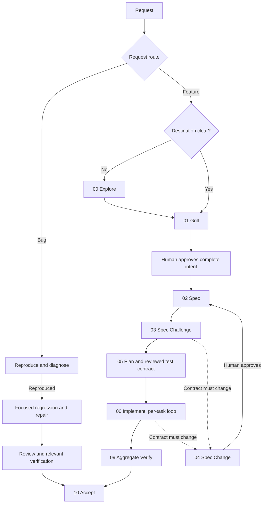

# AskIt developer guide

AskIt helps you turn a request into agreed requirements, reviewable changes,
and evidence that the result works. You own the goal and the decisions. The
agent investigates, writes the engineering artifacts, implements, tests, and
records what happened in Git.

This guide describes the implementation in this repository. The canonical
stage contracts live in [`.agents/ask/stages/`](../../.agents/ask/stages/), and
the operating rules live in [`AGENTS.md`](../../AGENTS.md) and
[`_ask/policies/`](../policies/). Follow those if a customized installation
differs from this guide.

## Read this in three passes

1. Follow [the first-workstream walkthrough](#1-set-up-your-project).
2. Use [the stage reference](#4-understand-each-stage) while working.
3. Return to [options and recovery](#5-handle-changes-interruptions-and-resume)
   when you need them.

For a comparison with the neighboring Superpowers checkout, read
[AskIt and Superpowers](askit-vs-superpowers.md).

## 1. Set up your project

### Install once, then add AskIt to a Git repository

The root [README](../../README.md#how-a-product-uses-this-kit) documents the
PATH installer for `askit`. If you already have this kit cloned, you can
inspect the overlay before installing it:

```bash
# Run from the kit clone. Replace the example path.
./ask install --dry-run /path/to/your/app
./ask install /path/to/your/app
```

Alternatively, run `askit` inside your application's Git repository. It asks
before adding AskIt to a repository that does not have it. A folder without
Git is refused. Installation preserves product `src/`, `tests/`, `scripts/`,
and `docs/`; the kit primarily lives under `_ask/` and `.agents/ask/`.

Inside an installed project, `askit` and `./ask` reach the same dispatcher.
This guide uses `./ask` so commands work without a PATH installation.

### Prepare the repository

```bash
./ask access-check
./ask check-clean
./ask prepare
./ask sync
```

| Command | What it does | What to watch for |
| --- | --- | --- |
| `access-check` | Probes workspace and Git metadata write access | Run at session start and resume; stop if it fails. |
| `check-clean` | Checks for uncommitted and untracked changes | Decide how to preserve existing changes before starting work. |
| `prepare` | Installs pinned community skills | Needs the skills installation tooling/network; required-skill failures block preparation. |
| `sync` | Generates stage skills, commands, and runtime agents | Generated files can change; review and commit setup changes before starting a workstream. |

AskIt expects an integration branch named `develop`. If your project does
not have one, choose its intended starting commit and create it deliberately.
`start-work` refuses to silently use `main` instead. It also recognizes
`origin/develop` when a local `develop` is absent.

### Configure verification and optional tracker access

Check [`.agents/verification.yaml`](../../.agents/verification.yaml). This is
your project's committed **CheckPlan**: which checks run, whether E2E applies,
and which verification presets/adapters are used. The kit repository uses its
own `ask-kit` preset; an application needs checks appropriate to that
application. Empty plans and zero mandatory checks fail.

For tracker/MCP integration, **you**, in an interactive terminal, run:

```bash
./ask setup
```

Agents must not run this wizard. It writes ignored credentials/context to
`.ask.env` and `.ask/tracker-context.md`, public tracker metadata to
`.ask/tracker.md`, and MCP stubs to `~/.cursor/mcp.json` using environment
references. Review the public metadata before committing it. Tracker setup is
separate from installing the kit; it does not replace repository artifacts.

## 2. Start with a useful request

You do not need to run every stage manually. Tell the agent the outcome and
how far it may proceed. For example:

> Add CSV export to the orders page. Support staff need to analyze the orders
> currently visible after filtering. Export the visible columns, including
> headers. Do not add scheduled exports or change permissions. Use work ID
> `orders-csv`. Continue through verification and present the result for acceptance.

The agent first chooses the route against existing accepted behavior:

| Your request | Route | First useful action |
| --- | --- | --- |
| “Add filtered CSV export.” | Feature | Decide whether the destination is clear enough for Grill. |
| “CSV export includes orders hidden by the filter, although it should export only visible orders.” | Bug fix | Reproduce the reported violation of the existing contract. |
| “Fix the export filter and add scheduled exports.” | Mixed | Separate the repair and feature, record dependencies, and serialize shared-file work. |

A bug that cannot be reproduced leads to more investigation, not an invented
fix. A request that changes the accepted behavior is feature work even if it
is phrased as “fix.” Direct stage commands still go through this route gate.

For a reproduced bug, the agent takes the focused route: record the expected
and observed behavior, reproduce it in the reporter's context, add and execute
the focused regression, make the minimal repair, and review/verify it against
the existing contract. The repair record replaces a new feature spec/plan.
Existing passing edge guards remain Green checks. Applicable branch,
cleanliness, scope, review, meaningful-commit, and verification rules still
apply; the short route does not waive them.

### Foggy or clear?

- **Foggy:** “Help support staff get useful order data.” Start Explore to
  decide who needs what and which solution is worth pursuing.
- **Clear:** “Export the filtered order table as CSV with these columns.”
  Skip Explore and clarify the remaining important decisions in Grill.

For a new feature in ordinary chat, the agent offers **Start Explore** /
**Start Grill** choices and waits for your selection. An explicit
`/00-explore` starts the kit's Explore stage. `/01-grill` does not make an
unclear destination clear; the agent returns to Explore when necessary.

### Create the workstream

After resolving request context and any entry choices, the agent runs:

```bash
./ask check-clean
./ask start-work orders-csv
```

This creates or checks out `agent/orders-csv` and seeds
`work/orders-csv/` with intent, plan, review, verification, and acceptance
templates. New branches start from `develop`. Seeded files are placeholders,
not approved requirements or completed evidence. The agent fills and commits
them as work proceeds. `start-work` deliberately does not create an Explore
map unless Explore actually runs.

## 3. Know the flow and the decisions you own



**04 Spec Change is an interrupt.** You do not need a change proposal for an
unchanged specification. With an active task graph, **07 Review and 08
Refactor run inside each implementation task**; the outer flow does not add
another unconditional review/refactor pass afterward.

The normal feature path has two main human confirmations:

1. Approve the **complete intent and assumptions** before implementation.
2. **Accept the workstream** after reviewing the result and evidence.

These are not the only possible questions. You also own unresolved product
decisions, scope changes, required model selections, risk escalations, and
release actions. After a decision is submitted, the agent should continue
within that authorization without repeatedly asking for it.

You can add context alongside a selection. If the runtime cannot preserve a
choice and comment together, numbered options plus a reply such as
`2 — keep the existing filename format` are valid. A highlighted default is
not a submitted decision.

## 4. Understand each stage

Use Cursor commands `/00-explore` through `/10-accept`, or Codex skills
`$kit-00-explore` through `$kit-10-accept`. These select instructions for an
agent; they are not shell commands. `./ask` commands manage branches,
validation, state, and evidence. A stage invocation does not automatically
approve its inputs or authorize later stages beyond your stated endpoint.

### 00 Explore — decide where to go

**Use it when:** the desired outcome, user, or solution direction is unclear.

The agent investigates the repository, maps decisions, and can use research
or throwaway prototypes to test ideas. It separates facts it can find from
choices only you can make. Before decision questions, it offers up to three
extra domain skills only when they could change What or Why; selected skills
are pinned before preparation.

**You provide:** users, needs, constraints, priorities, and decisions between
meaningful alternatives. Discovery is not permission to ship a prototype.

**Output:** `work/<work-id>/explore-map.md`, including a non-empty
`Handoff to Intent` section. The handoff explains the destination well enough
to enter Grill.

**Nuance:** a real skip creates no map. Instead, intent records
`Explore skipped: destination already clear.` If you explicitly requested
Explore for a feature, the map is required.

### 01 Grill — agree on What and Why

**Use it when:** the destination is clear enough to make the request explicit.

The agent asks load-bearing questions: choices that affect scope, reversibility,
constraints, non-goals, or other decisions. It looks up repository facts
itself. Questions include alternatives, trade-offs, and failure modes; routine
defaults go in a short “I'll assume…” list. For a user-facing deliverable,
this includes intended users, essential workflows, and interaction expectations.

For CSV export, useful questions include “All filtered rows or only the current
page?” and “Which timezone should exported timestamps use?” Asking you to locate
the existing export helper is investigation the agent should do.

**Output:** `work/<work-id>/intent.md` with What, Why, non-goals, assumptions,
decisions, and the E2E contract. E2E is either applicable, with journeys,
environment, data and reset, or `not_applicable` with a reason.

**Your gate:** the agent prepares and commits the full intent and required
scaffold, then presents **Approve complete intent and assumptions** /
**Request changes**. Approval is recorded against that exact document:

```bash
# Agent runs this only after your submitted approval.
./ask confirm-intent --work-id orders-csv --choice approve
```

Editing the intent makes the confirmation stale. Approving a direction or
saying “implement” does not approve an unseen complete intent. Unsolicited
concise affirmative text can be recorded with `--response`; you should not
be asked to repeat a prescribed approval sentence.

### 02 Spec — define observable behavior

The agent translates intent into requirements and observable acceptance
criteria. It preserves Why and separates requirements from implementation
preferences. “CSV contains only filtered orders” is a requirement; “use this
particular library” needs its own justification or explicit constraint.

**Outputs:** a Markdown proposal under `specs/proposals/<work-id>.md`, then
the current specification under `specs/current/`, plus canonical criterion
metadata at `specs/current/<work-id>.json`. Stable criterion IDs connect
requirements to later tests. The spec carries forward the E2E contract.

**Nuance:** after intent approval, the agent prepares the spec and marks it
CURRENT unless you limited the endpoint. This normally needs no second
approval of unchanged What/Why. Specifications use the prepared
`writing-for-agents` skill; `humanizer` does not rewrite these agent contracts.

### 03 Spec Challenge — try to break the specification

An independent agent searches for ambiguity, contradictory constraints,
unsupported assumptions, unobservable criteria, and counterexamples. It also
challenges required test types and review-only criteria.

**Output:** `work/<work-id>/spec-challenge.md`, with model/runtime/parent
attribution and a PASS or ESCALATE result.

**Your gate:** choose the challenge model from the runtime's options. A
same-family choice requires an explained **Continue with this model** /
**Choose another model** decision. The parent cannot substitute its own
self-review for the required independent challenge. If the runtime cannot
perform that review, report the gap rather than claiming it happened.

PASS allows progress within scope. ESCALATE needs your decision. A challenge
does not authorize silently changing the agreed requirements.

### 04 Spec Change — change the agreement explicitly

**Use it when:** investigation, implementation, review, or analytics reveals
that the accepted contract should change.

The agent preserves the current accepted spec and prepares a proposal using
the [Spec Change template](../templates/spec-change.md): reason, alternatives,
impact, and the proposed behavior. You choose **Approve spec change** /
**Keep current spec**.

If What, Why, or assumptions also change, the agent presents the proposal and
complete revised intent together so one submitted decision can authorize the
linked changes. A test failure alone is not a reason to weaken criteria.
Changed contracts and test mappings need renewed independent review/pinning.

### 05 Plan — make the work executable and bounded

The plan references one accepted specification and identifies components,
dependencies, risks, verification, and escalation points.

**Outputs:**

- `work/<work-id>/plan.md`: approach and reviewable work breakdown.
- `work/<work-id>/inner-loop/tasks.yaml`: task graph with stable task IDs,
  outcomes, dependencies, owned-path globs, and completion evidence.
- `work/<work-id>/test-plan.json`: criteria, required test types, explicit
  cases/assertions/source paths, and the exact responsible task IDs.

One cohesive deliverable may be one task; explain why further splitting
would be artificial. Independent deliverables deserve separate tasks.
Tasks sharing files must run in sequence. Tasks with no executable test need
a specific verification rationale.

The graph and test mapping are checked, independently reviewed, and pinned
before implementation. The agent records the reviewed contract with
`./ask traceability accept-plan`; a written plan alone does not establish
that pin. See [the exact evidence procedure](spec-test-traceability.md).

**Your role:** decide genuine unresolved design questions. The agent does not
ask for a routine second blessing of a plan already within approved intent.
If you said “stop after planning,” implementation remains unauthorized.

### 06 Implement — work through the accepted tasks

Before feature implementation:

```bash
./ask check-workstream orders-csv
./ask inner-loop validate orders-csv
./ask inner-loop status orders-csv
./ask inner-loop run orders-csv
```

The runner coordinates the next action; it is not a replacement for the coding
agent. The agent implements only reviewed task IDs and their owned paths.
`owned_paths` are module/seam globs, so new files inside a permitted module
can be in scope without listing every filename in advance.

Each behavioral slice follows:

1. Write and execute a failing behavior test at a committed **Red** revision.
2. Make the smallest **Green** implementation and run the relevant checks.
3. **Refactor** while keeping behavior and checks green.
4. Commit the candidate and obtain independent **Review**.
5. Correct findings, rerun applicable checks, and obtain fresh review after
   any candidate change.
6. Integrate only the approved current candidate with passing evidence.

An import/setup error is not a valid behavior Red. Existing regression guards
need current Green execution; they do not need manufactured historical failures.
Documentation, generated projections, and nonbehavioral configuration have
typed, independently acknowledged TDD exemptions. They do not excuse behavior
changes. Structural cleanup keeps existing checks green without inventing a
new behavior test.

**Outputs:** code, tests, meaningful commits, candidate-bound TaskResults and
review/execution evidence. The coordinator records review authority; a worker's
own `approved` or `green` field cannot authorize integration.

**Nuance:** only one task writer may have unintegrated commits. Optional task
worktrees stay inside the workstream and integrate by fast-forward only;
cherry-picking/rebasing task commits onto the coordinator is forbidden.

### 07 Review — inspect the exact candidate independently

The reviewer checks accepted behavior, project rules, changed tests, and the
task boundary. Findings need evidence and concrete locations. Runtime model
selection and same-family acknowledgment work like Spec Challenge; default
review selection also depends on risk.

**Outputs:** `review.md` and/or candidate-bound task evidence, with an
APPROVED or REJECTED task verdict and boundary classification.

| Finding | What happens next |
| --- | --- |
| Valid structural cleanup within the task outcome | Fix it and obtain fresh review. |
| Existing-spec behavior defect | Focused Red → Green → Refactor, then fresh review. |
| Broader refactor beyond this task | Preserve an attributed later-work draft. |
| Requirement/meaning must change | Stop for Spec Change. |
| Mistaken finding | Reviewer withdraws it with evidence. |
| Unnecessary change outside owned paths | Treat as extras; remove it through the runner's remediation process. |
| Required change outside owned paths | `glob_too_narrow`; amend the reviewed scope before proceeding. |

The reviewer commits nothing. Its verdict applies to one exact candidate;
changing code or bound evidence invalidates the prior approval.

### 08 Refactor — close findings without changing the goal

Inside an active task graph, every valid task-local finding must be fixed and
freshly reviewed, or withdrawn by the reviewer with evidence. Unsafe or
ambiguous findings remain escalated. If no useful cleanup applies, record
that outcome and leave the code alone.

Outside an active graph, findings use FIX, ACCEPT WITH RATIONALE, or ESCALATE.
That broader disposition does not override the stricter active-task rule.
Marking something FIXED requires rerunning its relevant verification.

Broader-refactor suggestions remain candidate-bound drafts while any writer
or resumable candidate exists. The coordinator deduplicates and materializes
`.later/<slug>.md` cards only after integration, then publishes through normal
`develop` integration. It must not switch a writer's branch to publish cards.

### 09 Verify — produce final workstream evidence

```bash
./ask verify
```

This executes the CheckPlan and, for a normal workstream, the structured
spec-to-test completion gate against committed candidate source. It retains
the source SHA, check output, actual per-case execution, and criterion coverage.
The declared E2E checks run unless E2E is explicitly inapplicable with a reason.

Do not replace this command with an ad hoc `pytest`/`npm test` wrapper. Put
project check commands in the CheckPlan/presets. Focused development tests
are still useful, but do not replace final verification.

**Important implementation limit:** the current structured case runner supports
explicit Python `unittest` selectors/discovery. Unsupported runners and dynamic
subtests refuse structured completion. A passing static shell command cannot
stand in for supported per-case evidence. A non-Python project can run static
checks, but needs supported adapter work before claiming this full completion
contract. See [traceability](spec-test-traceability.md) before adopting it.

Verification outside a workstream branch runs repository static checks; it
does not authorize a workstream pass. Source changes must be committed first.
Narrow runtime-output exceptions exist for evidence/state, not for arbitrary
dirty source files. Archive evidence citing its tested SHA; a later
evidence-only commit is not the same as retesting changed source.

### 10 Accept — let the human close the workstream

The agent assembles the result, limitations, commit SHA, and evidence:

```bash
./ask traceability check-completion orders-csv
./ask check-workstream orders-csv --acceptance
./ask record-result --work-id orders-csv --commit-sha <tested-full-sha> --result pass
```

These commands re-evaluate underlying contracts and evidence. Editing a
completion JSON field to `pass` cannot make work complete. Task-level success
cannot substitute for final workstream success.

**Outputs:** `work/<work-id>/acceptance.md`, result provenance, and
`context-audit.md`. The context audit must exist and have no checklist IDs
left `open`; closed IDs are `pass` or a Spec Change link. Acceptance records
the audit path/SHA and tested source SHA.

**Your gate:** **Accept workstream** / **Request changes**. Default feature
closure waits for your submitted acceptance. The stage can report
AUTO_ACCEPT_ELIGIBLE, HUMAN_APPROVAL_REQUIRED, or REJECT, but automatic
acceptance requires actual delegation-policy permission.

Acceptance does not itself merge, push, tag, or release. `develop` is the
integration branch; `main` is releasable. Agents can prepare PRs and release
evidence. Humans authorize merge/tag/push to `main` under the Git-flow policy.

## 5. Handle changes, interruptions, and resume

### Resume the right work

Say `Continue orders-csv`, preferably with your intended endpoint. The agent
runs access preflight, inspects branch/artifacts, task state, and recent
commits, and resumes the exact authorized stage.

```bash
./ask status
./ask status --work-id orders-csv
./ask inner-loop status orders-csv
```

An explicitly named workstream takes precedence over the checkout. Without
a name, a matching checked-out `agent/<work-id>` is preferred. Ambiguous
targets or conflicting authorization need clarification.

“Continue” does not override “stop after planning.” Say “Continue orders-csv
through verification and present it for acceptance” to extend that endpoint.
If What/Why/assumptions are unchanged, the agent records the new authorization
in the plan or a scoped record and preserves approved intent byte-for-byte.

For runner interruption, the coordinator uses documented `interrupt`, `reopen`,
`reconcile`, checkpoint, or `resume` operations as appropriate. `resume` can
repair source/Git state to the recorded coordinator revision; it is not a
read-only status command. Inspect state before using repair commands. Keep
lock/state files intact. See [recovery mechanics](inner-loop-evidence.md).

### Deal with unrelated changes

Before labor starts, a dirty tree requires an explicit decision for each
uncommitted/untracked path: commit, stash, discard, move, or preserve for
another workstream. The agent must not silently stash/reset or absorb them.
Expected edits during an authorized task are committed at meaningful steps.

### Park a discovery

An unrelated improvement belongs in `.later/<slug>.md`, using the
[later-work template](../templates/later-work.md), rather than a second
unrequested workstream. A card is a proposal, not authorization or live work.
Active task-review drafts follow the delayed publication rule in stage 08.

For urgent new work interrupting an existing stream, the human chooses the
base: current branch, `develop`, or `main`. The protocol calls for a separate
workstream and fresh isolated context while preserving the interrupted one.

### Leave the feature workflow for one chat

`/off-path`, “skip the kit,” or “just code” leaves the feature-artifact path
for that chat. The agent warns once and follows the requested style; a new
chat starts on-path. There is no durable `kit-path` flag to commit.

This does not waive request routing, reproduction-first bug diagnosis, scope,
data preservation, or evidence honesty. It is not permission to silently
change accepted behavior or claim unperformed checks. For normal feature
implementation on the kit path, missing/stale intent confirmation blocks
`check-workstream`; `--allow-dirty` is not an intent-approval bypass.

### Develop AskIt itself

The root self-development rule overrides kit workflow gates for changes to
the kit. Keep it disabled and work directly. Dogfooding requires a separate,
frozen copy: record its exact commit and location before enabling it, keep
that pin unchanged during the task, and deliberately upgrade between tasks.
Do not use the changing checkout to govern its own development.

## 6. Choose skills, models, and local customizations

### Community skills and kit stage skills are separate

| Layer | Example | How to change it |
| --- | --- | --- |
| Community method | `.agents/skills/grilling/SKILL.md` | Change its reviewed source/version pin in `_ask/skills/manifest.yaml`, then prepare. |
| Canonical kit stage | `.agents/ask/stages/01-grill.md` | Kit development changes this source. |
| Consumer stage additions | `.agents/ask.local/stages/01-grill.md` | Add project-specific instructions, then sync. |
| Generated invocation | `.agents/skills/kit-01-grill/SKILL.md`, `.cursor/commands/01-grill.md` | Regenerate with sync; do not hand-edit. |

The kit can change how Grill is run without rewriting the original `grilling`
skill. Invoking `$kit-01-grill` selects the kit stage; invoking `grilling`
selects the community method. Repository instructions still apply.

The skill manifest records `source`, `revision`, `skill`, `role`, and optional
`required`. Use deliberate version pins; never `latest` for critical methods.
Commit the manifest and CLI `skills-lock.json`; prepared community bodies are
regenerated and ignored. Generated `kit-*` skills are committed and reserved
for AskIt. Sync preserves unrelated skill names and refuses unsafe/unmarked
reserved directories.

```bash
# Validate the preparation pins without installing dependencies.
SKIP_INSTALL=1 ./ask prepare
# Install the reviewed pins.
./ask prepare
# Rebuild stage skills, commands, and agents.
./ask sync
```

Already-required pins prepare normally. Extra domain skills that could change
What/Why require selection before installation. `required: false` is not a
reason to assume that skill is installed; inspect preparation results.

### Model selection is configurable by stage and risk

Portable stage roles live in `.agents/ask/bindings/models.defaults.yaml`;
runtime bindings map roles to model names. Review pools follow risk:
LOW/MEDIUM use `cheap`; HIGH/CRITICAL use `diverse`; unset risk is LOW.
Risk considers reversibility, impact, data loss, and security, not line count.

Repository overrides can live in `_ask/bindings/models.yaml` or
`.agents/ask.local/bindings/models.yaml`. A workstream can override a specific
job in `work/<work-id>/models.yaml`:

```yaml
codex:
  06-implement: gpt-6.1-sol
reasoning_effort:
  codex:
    06-implement: high
```

```bash
ASK_WORK_ID=orders-csv ./ask sync
# Without ASK_WORK_ID, sync restores repository-default assignments.
```

This is a configured example, not a promise that your account/runtime offers
that model. Choose a model available in your environment. Stage environment
overrides and reasoning-effort settings are documented in
[Codex model routing](codex-model-routing.md). Effort resolves independently
from model selection; it supports explicit inheritance. Regenerating files
does not change an already-running agent, and a client may cache role config.

The stage contracts require independent Challenge and Review agents. Optional
Grill/Plan agents can draft, but the parent retains the conversation and final
artifact responsibility. Merely using a different model name does not prove
cross-family independence.

### Keep consumer changes in preserved locations

Use `.agents/ask.local/` for stage/binding overlays,
`.cursor/rules/local/` for local Cursor rules, and
`.agents/verification.yaml` for project verification. The legacy
`_ask/agents/<stage>.local.md` overlay is used only when its corresponding
`ask.local` stage file is absent. Sync generates agent files for Cursor,
Claude Code, Codex, and OpenCode; availability/invocation still depends on
the runtime's actual capabilities.

Upgrade explicitly:

```bash
./ask upgrade --version <tag-or-sha>
```

Kit-owned files refresh; consumer manifest, work/specs, local overlays, and
CheckPlan are preserved under the ownership rules. Review the diff and rerun
preparation/sync/checks. `--skip-prepare` skips dependency installation; it
does not imply that projections or migrations are skipped. Older consumer
installations may need the target-checkout migration procedure in
[Codex integration](codex-integration.md#migrating-a-consumer-installed-before-codex-stage-skills).

## 7. Optional tools beyond the basic workflow

### Engineering Model and workbench

`work/<work-id>/engineering-model.json` is an optional sidecar that organizes
intent, requirements, scenarios, decisions, tasks, and their relationships.
It does not replace canonical specs, test plans, or execution evidence.
A task labeled `done` is not proof it ran.

```bash
./ask model validate --work-id orders-csv
./ask model show --work-id orders-csv
./ask model --help
```

`admit` publishes validated immutable generations; it grants no execution or
acceptance authority. `edit` uses an expected full snapshot digest and a JSON
batch for guarded changes. `watch` observes saves; validation still applies.
Invalid working definitions are noneditable through ordinary guarded actions,
and readers may see an explicitly last-validated generation. V1-to-V2 migration
is explicit and independently reviewed, never triggered by reading a file.

Explore/Grill use `stage-intake` to resolve initial subject context before
creating execution work. An explicit qualified subject overrides a recorded
association; tracker references and later cards are context/proposals, not
ownership assignments. Confirmed associations carry their source revision,
bounded contribution, exclusions, and execution owner into intent.

For the optional local UI:

```bash
python -m pip install -r _ask/ui/requirements.txt
./ask ui
```

The workbench displays admitted state and guarded decision forms. It does not
automatically execute work or repair invalid definitions. Read
[Engineering Model](engineering-model.md) for schema, migration, watcher,
publication, and local POSIX cooperation limits.

### Exact workflow references

Numeric qualified references identify an exact immutable revision:

```bash
# Example shape; this reference must exist in your repository's catalog.
./ask refs show shorter-hashes/spec/1/plan/1/task/8/test/1@1
./ask refs status
```

Owner and parent context are part of the identity. Lookups do not fall back
to the current branch, newest revision, or a shortened Git prefix.
`--integrity` adds digest details; projection options select exact JSON fields,
items, Markdown sections/rows, or YAML tasks after source verification.
Impact, attributable decisions, explicit legacy migration, export/import,
and authority-registration limits are covered in
[workflow references](workflow-references.md).

### Experiment provenance

`record-run` is for measured experiments, separate from workstream
`record-result`. Commit code/config before running the experiment. Record its
actual metric against exact HEAD, with a clean source tree and an existing
`results/<run-id>/config.yaml` unless you select another output root.

```bash
./ask record-run --run-id experiment-a --commit-sha <full-head-sha> --metric <measured-value>
```

This records provenance; it does not run training or prove a claim about the
metric. The [facilitator demo](demo/end-to-end-plan.md) shows a complete example.

## 8. Command and option desk reference

Run `./ask --help` for the installed version and each command's `--help` for
schemas and advanced flags. These are the main developer-facing choices:

| Command | Options and cautions |
| --- | --- |
| `access-check`, `check-clean` | No flags. Access and cleanliness are separate checks. |
| `start-work <id>` | Required work ID; creates/seeds the workstream from `develop`. |
| `confirm-intent --work-id <id>` | `--choice approve\|revise`, or `--response <exact-human-text>`; records a real submitted decision. |
| `check-workstream <id>` | `--allow-dirty` skips only cleanliness; `--acceptance` checks final completion requirements. |
| `status` | `--work-id <id>`, `--json`, `--work-only`, `--later-only`; refs are the workstream inventory, not just files visible in the checkout. |
| `prepare` | `SKIP_INSTALL=1` validates pins without installation. |
| `sync` | No flags; `ASK_WORK_ID=<id>` applies workstream model overrides. |
| `install <repo>` | `--dry-run` previews; `--force` overwrites kit-owned files; `--skip-prepare` skips dependency installation. Review ownership before forcing. |
| `upgrade --version <tag-or-sha>` | Explicit version required; `--source <git-url>` or `KIT_SOURCE_REPO` selects source; optional `--skip-prepare`. |
| `verify` | No flags; `VERIFY_OUT_DIR` and `VERIFY_JSON` control outputs. |
| `record-result` | Required `--work-id`, `--commit-sha`, `--result`; optional `--notes`; pass requires valid final evidence. |
| `record-run` | Required `--run-id`, `--commit-sha`, `--metric`; optional `--notes`, `--out`; SHA must be HEAD. |
| `inner-loop` | Normal operations: `validate`, `status`, `run`, `resume`, `cancel`; advanced review, interruption, checkpoints and repair require their documented evidence/state inputs. |
| `traceability` | `validate-plan`, `accept-plan`, `record-review`, `run`, `check-completion`, `migrate`; migration scaffolds missing contracts and invents no historical evidence. |
| `model` | `validate`, `admit`, `show`, `edit`, `watch`, `context`, `migrate`; document admission is distinct from workflow permission. |
| `stage-intake` | `--stage 00-explore\|01-grill --work-id <id> --request <json>`; read-only context resolution. |
| `refs` | `show`, `status`, `impact`, `decide`, `migrate`, `export`, `import`; exact revision/authority semantics apply. |
| `ui` | Accepts Streamlit options; optional UI dependencies required. |
| `setup` | Human-only interactive wizard; `--help` is safe without a TTY. |
| `completion bash\|zsh` | Prints completion code for debugging; PATH `askit` installs completion hooks itself. |

`status` reads live and archived workstreams from Git refs without checking
them out. Later-card visibility has checkout/integration context; if a card
seems missing, inspect its publication branch and the detailed status output.
It is never automatically active work. Do not maintain a competing committed
`work/INDEX.md`.

## 9. When something blocks progress

| Symptom | Next useful action |
| --- | --- |
| Access preflight fails | Restore access to the named workspace/Git location before project work. |
| `start-work` cannot find `develop` | Choose and create the integration branch; do not bypass by branching implicitly from `main`. |
| Dirty-tree refusal | Resolve each existing path with an explicit preservation choice. |
| Missing or stale intent confirmation | Present and approve the exact complete intent; preserve prior unrelated decisions. |
| Spec/plan placeholders are empty | Prepare the required artifacts within accepted intent before feature implementation. |
| `migration_required` | Update the coordinator/contract tooling and obtain missing reviewed pins; do not fabricate old Red or approval evidence. |
| Tests pass but completion fails | Inspect criterion mapping, accepted contract, actual case execution, candidate SHA, and independent review freshness. |
| Task approval became stale | Rerun applicable checks and obtain review for the changed candidate. |
| Needed file is outside owned paths | Amend and independently review the task scope; do not quietly broaden it. |
| Acceptance refuses | Check final completion evidence and every open context-audit ID. |
| Generated skill edits disappear | Edit the canonical stage or consumer overlay, then sync. |
| New model assignment is ignored | Check workstream overrides, effective spawned model, and cached client role configuration. |
| Agent asks for approval at every stage | Point to the recorded intent and endpoint; unchanged prepared artifacts normally do not need repeated blessings. |

## Source map

| Question | Authoritative starting point |
| --- | --- |
| What should the agent do now? | [AGENTS.md](../../AGENTS.md), [workflow policy](../policies/workflow.md) |
| What does a particular stage require? | [Stage contracts](../../.agents/ask/stages/) |
| What happens inside an implementation task? | [Task loop](../../.agents/ask/task-loop.md), [runtime evidence](inner-loop-evidence.md) |
| What proves a requirement was tested? | [Spec-to-test completion](spec-test-traceability.md) |
| What can the agent do without asking? | [Delegation](../policies/delegation.md), [risk](../policies/risk.md) |
| How are branches and commits handled? | [Worktree policy](../policies/worktree.md), [Git-flow](../policies/git-flow.md) |
| What survives upgrade? | [Owned paths](../OWNED-PATHS.md) |
| How are runtime skills and models generated? | [Codex integration](codex-integration.md), [model routing](codex-model-routing.md) |
